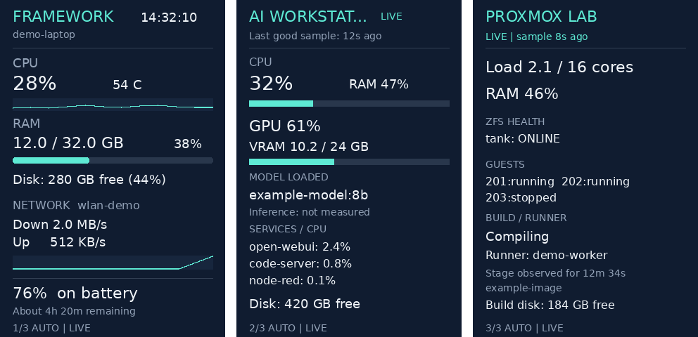

# Turing Dashboard

A small Linux dashboard for a 3.5-inch TURMO/Turing Revision A USB display.
It runs on your computer, not on the display, and does not change firmware.

The laptop page shows CPU load and temperature, RAM, disk space, network rates,
short CPU/network histories, and battery status/runtime when reported by Linux.
Extra pages read local telemetry snapshots from your existing collectors:
an AI workstation page shows GPU/VRAM and loaded models; Proxmox pages show
host load/RAM, ZFS, guest states and optional build-worker information.

Pages rotate every ten seconds by default. Laptop readings refresh every two
seconds. Cached remote readings retain their original sample time and show
LIVE, STALE, OFFLINE or UNAVAILABLE rather than turning missing readings into
zero. **A loaded model is not proof that inference is running.**

Warnings can bring a newly affected page forward. Manual page pinning takes
priority over warnings. Optional timed dimming and a user-service example support
everyday desktop use. See [controls and warnings](docs/operation.md).

## A look at the pages



Left to right: Framework laptop, AI workstation and Proxmox lab. These are
**synthetic previews**, not live infrastructure readings or photographs of the
display. All names, figures, guest states and build details are examples.
The AI page deliberately says inference is not measured; a loaded model alone
does not establish activity. The build timer shows observed stage duration.

Full-size pages: [laptop](docs/images/laptop.png),
[AI workstation](docs/images/ai-workstation.png), [Proxmox](docs/images/proxmox.png).
Regenerate with `.venv/bin/python docs/render_previews.py` after installing the
package. This uses the real renderers with mocked system readings and no USB,
local snapshots or network access.

## Status and hardware

This is an early release candidate. The original laptop/AI-workstation dashboard
has been tested on a TURMO 3.5-inch display: USB `1a86:5722`, identifier
`USB35INCHIPSV2`, 320 x 480 portrait, Turing Revision A protocol. The configurable
package and Proxmox page are new; do not assume every screen or collector has
been hardware-tested. Other hardware revisions and desktop video output are not
supported. See [hardware notes](docs/hardware.md).

## Install and run

Use Python 3.10 or later on Linux. From a source checkout:

```sh
python3 -m venv .venv
.venv/bin/python -m pip install .
.venv/bin/turing-dashboard
```

The default is a laptop-only page and automatic detection of one matching
Revision A display. Your user needs access to its serial port; do not run the
application as root or make serial devices world-writable. Stop with Ctrl+C.
The last image stays on screen; unplugging the screen removes power.

For additional pages, copy `examples/config.example.json` to `config.local.json`,
remove any pages you do not use, and set the display name and cache paths:

```sh
.venv/bin/turing-dashboard --config config.local.json
```

Keep local configuration untracked. The example names are labels, not configured
connections to any company infrastructure. Missing snapshot files show a waiting
page. The display application never opens SSH, contacts Proxmox or starts a
second remote polling loop. See [collector integration](docs/snapshots.md).

### Preview without USB

```sh
.venv/bin/turing-dashboard --config config.local.json --preview-dir /tmp/turing-previews
```

This writes a PNG per page without opening the serial port. Previews contain
your current local readings and any configured cache data: review them before
sharing. Rendering a preview does not prove hardware delivery or remote health.

## Safety and limits

- Brightness is limited to 50% because upstream warns Revision A units can get
  hot at higher levels. No reset, firmware update or bootloader operation is used.
- A dock disconnect permits two reconnect retries, two seconds apart; persistent
  I/O failure stops the application. The CLI does not install a service or
  autostart entry automatically; optional user-service setup is documented.
- CPU temperature and battery runtime depend on OS sensor support. Network rates
  use the IPv4 default route; IPv6-only route detection is not yet implemented.
- ZFS and service labels reflect collector reports, not an independent audit.
  Missing container stats mean not reported, not necessarily stopped.

## Development

```sh
.venv/bin/python -m unittest discover -s tests -v
```

Tests use temporary synthetic caches and serial mocks; they do not contact real
infrastructure. See [CONTRIBUTING.md](CONTRIBUTING.md) and [SECURITY.md](SECURITY.md).

## Licence and credits

**GPL-3.0-or-later**, retaining the licence of the adapted Revision A protocol
implementation from [turing-smart-screen-python](https://github.com/mathoudebine/turing-smart-screen-python).
See [LICENSE](LICENSE) and [NOTICE](NOTICE) for the text, copyright notices and
reference revision. No vendor firmware, upstream themes or fonts are bundled.

Prepared for Dynamic Devices. Briar helped draft and implement this software
with Alex J Lennon; hardware feedback came from Alex. No vendor endorsement is
implied. This is development source, not a published versioned release. Check
the repository's pull requests for current review and merge status.
